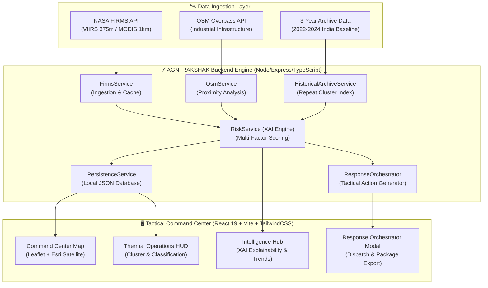

# 🔥 AGNI RAKSHAK AI (अग्नि रक्षक)

<div align="center">


### **Next-Gen Satellite Earth Observation & Explainable AI for Wildfire Detection & Industrial Heat Source Monitoring**

[](LICENSE)
[](https://react.dev/)
[](https://www.typescriptlang.org/)
[](https://vitejs.dev/)
[](https://tailwindcss.com/)
[](https://expressjs.com/)
[](https://firms.modaps.eosdis.nasa.gov/)
[](https://www.openstreetmap.org/)
[](#)

[Explore Features](#-key-capabilities) • [System Architecture](#-system-architecture) • [AI Risk Engine](#-explainable-ai-xai-risk-engine) • [Quick Start](#-quick-start) • [Presentation Demo](#-presentation-mode--judge-flow)

</div>

---

## 📌 Executive Summary

**AGNI RAKSHAK AI** (*Protector Against Fire*) is a mission-critical geospatial command and intelligence platform engineered for **real-time wildfire detection**, **agricultural burn classification**, and **industrial heat-source discrimination**.

Conventional fire monitoring systems suffer from high false alarm rates because recurring industrial thermal flares (refineries, power plants, steel mills, brick kilns) trigger the same thermal thresholds as wild brush and forest fires. **AGNI RAKSHAK AI** solves this by fusing:

1. **Near-Real-Time (NRT) Satellite Feeds** from NASA FIRMS (VIIRS 375m & MODIS 1km).
2. **OpenStreetMap (OSM) Overpass Geospatial Intelligence** to inspect industrial zoning, power stations, and chemical refineries within dynamic proximity radiuses.
3. **3-Year Historical Baseline Anomaly Engine (2022–2024)** indexing millions of historical thermal events across India to identify seasonal agricultural cycles and persistent heat sources.
4. **Transparent, Multi-Factor Explainable AI (XAI)** that outputs auditable risk scores (0–100) and actionable dispatch packages.

---

## 🚀 Key Capabilities

### 🛰️ 1. Multi-Sensor Satellite Thermal Ingestion
- Real-time ingestion of NASA FIRMS active fire data:
  - **VIIRS (SNPP & NOAA-20 / JPSS-1)** at ultra-crisp 375m resolution.
  - **MODIS (Terra & Aqua)** for calibrated thermal radiative flux.
- Direct capture of **Fire Radiative Power (FRP in Megawatts)**, brightness temperatures (`T4`/`T5`), scan/track angles, and sensor confidence levels.

### 🏭 2. False Alarm Elimination via Industrial Context
- Automatically queries the **OpenStreetMap Overpass API** within target radius coordinates.
- Classifies known industrial heat emitters:
  - Thermal power stations, gas flare stacks, steel foundries, petrochemical refineries, cement factories.
- Prevents unnecessary forest ranger dispatches by distinguishing industrial flares from uncontrolled wildfires.

### 🧠 3. Multi-Factor Explainable AI (XAI) Scoring Engine
- Translates raw sensor values into plain-English reasoning:
  - **Thermal Intensity (FRP)**: Energy output quantification.
  - **Persistence**: Recurrence rate across consecutive satellite passes.
  - **Industrial Offset**: Proximity discount when adjacent to registered plants.
  - **Historical Anomaly Score**: Comparison against 3-year baseline data.
- Generates transparent, human-readable scoring breakdowns (e.g., `+18 pts high FRP`, `-35 pts industrial proximity`).

### 🗺️ 4. Military-Grade Command Center HUD & GIS Mapping
- Dark-mode, high-contrast tactical map powered by **Leaflet & Esri Satellite World Imagery**.
- Dynamic thermal hotspot clustering, risk-graded pulsing markers (High / Medium / Low).
- Geographic region toggling: **Jhansi (Bundelkhand Focal Region)**, **All-India Coverage**, and **Global Operations**.

### ⚡ 5. Incident Response Orchestrator
- Transform detected critical threats into four-stage tactical action plans:
  1. **Sensor Verification** (Satellite cross-check).
  2. **Industrial Attribution** (OSM & facility validation).
  3. **Containment Monitoring** (Thermal perimeter tracking).
  4. **Emergency Dispatch Package** (Pre-formatted coordination report for local authorities and disaster teams).

---

## 🏗️ System Architecture



---

## 📊 Explainable AI (XAI) Risk Engine

The platform eliminates "black-box" decision-making by calculating an auditable **Thermal Risk Index (0–100)**:

$$\text{Risk Score} = w_t \cdot S_{\text{thermal}} + w_p \cdot S_{\text{persistence}} + w_c \cdot S_{\text{confidence}} - w_i \cdot S_{\text{industrial}} \pm S_{\text{historical}}$$

| Component | Weight | Metric Measured | Impact on Wildfire Risk |
|---|:---:|---|---|
| **Thermal Intensity ($S_{\text{thermal}}$)** | 35% | Fire Radiative Power (MW) & Brightness Temp | High FRP significantly increases priority |
| **Persistence ($S_{\text{persistence}}$)** | 20% | Repeated detections in same grid cell | Persistent rural fires indicate advancing front |
| **Detection Confidence ($S_{\text{confidence}}$)** | 15% | NASA sensor algorithm certainty | Eliminates optical glint and cloud false positives |
| **Industrial Proximity ($S_{\text{industrial}}$)** | 20% | Distance to OSM-tagged refineries / plants | **Reduces risk** (classified as controlled industrial) |
| **Historical Baseline Anomaly** | 10% | 3-year recurrence pattern (2022–2024) | Detects abnormal flare-ups outside seasonal norms |

---

## ⚡ Quick Start

### Prerequisites
- **Node.js** (v20.0 or higher recommended)
- **Git**
- Optional: NASA FIRMS free API key ([Get free key here](https://firms.modaps.eosdis.nasa.gov/api/config/))

---

### 🚀 1-Click Launch (Windows)
Double-click the included batch launcher in the project root:
```bat
START_AGNI_RAKSHAK.bat
```
*This script automatically verifies dependencies, starts the backend and frontend dev servers, validates the `/api/health` endpoint, and launches the application in your default browser.*

---

### 💻 Manual Installation & Execution

1. **Clone the repository:**
   ```bash
   git clone https://github.com/Nikhil9211/AGNI_RAKSHAK_AI.git
   cd AGNI_RAKSHAK_AI
   ```

2. **Install dependencies:**
   ```bash
   npm install
   ```

3. **Configure Environment Variables:**
   ```bash
   cp .env.example .env
   ```
   Edit `.env` and insert your NASA FIRMS key (optional, offline demo data works out-of-the-box):
   ```env
   FIRMS_API_KEY="your_nasa_firms_key_here"
   ```

4. **Start the application:**
   ```bash
   npm run dev
   ```

5. **Open in browser:**
   ```text
   http://localhost:3000
   ```

---

## 🎯 Presentation Mode / Judge Flow

For evaluation sessions, hackathon demos, or environments without live NASA API connectivity, AGNI RAKSHAK includes an isolated **Presentation Snapshot Mode**:

```text
http://localhost:3000/?demo=1
```

- **Zero Contamination**: Simulated data runs purely in-memory and never overwrites live databases or caches.
- **Pre-loaded Incident Scenarios**: Showcases simultaneous agricultural burns, industrial flares, and critical forest fires.
- **Interactive Response Orchestration**: Allows judges to test full trigger-to-dispatch workflow instantaneously.

---

## 🛠️ Technology Stack

| Layer | Technologies |
|---|---|
| **Frontend Framework** | **React 19**, **TypeScript**, **Vite 6** |
| **Styling & HUD** | **TailwindCSS v4**, Custom Cyber-Tactical Dark Theme |
| **Geospatial & Mapping** | **Leaflet**, **Esri World Imagery**, OpenStreetMap Overpass |
| **Icons & Animation** | **Lucide React**, **Motion** (Framer Motion) |
| **Backend & Server** | **Node.js**, **Express 4**, **tsx** |
| **Data Ingestion** | **NASA FIRMS REST APIs**, Gzip Historical Data Streams |
| **Storage & Persistence**| Zero-dependency persistent JSON store (`server/.data/`) |
| **AI Integration** | **Google GenAI** (`@google/genai`), Multi-factor XAI Scoring |

---

## 📂 Project Structure

```text
AGNI_RAKSHAK_AI/
├── src/
│   ├── components/
│   │   ├── hud/            # Tactical telemetry, intelligence HUD, orchestrator
│   │   ├── layout/         # Header, status badges, system settings modals
│   │   └── map/            # Leaflet GIS maps, thermal overlay renderers
│   ├── pages/
│   │   ├── CommandCenter.tsx   # Primary operational tactical view
│   │   ├── ThermalOperations.tsx# Heat signature & cluster classification
│   │   ├── Intelligence.tsx    # XAI breakdown, risk metrics & analysis
│   │   └── Alerts.tsx          # Real-time incident alert feed
│   ├── services/           # Frontend API client
│   └── types.ts            # Complete TypeScript domain interfaces
├── server/
│   ├── data/historical/    # 3-year MODIS & VIIRS India archive (2022-2024)
│   ├── db/                 # Local persistent database service & schema
│   ├── routes/             # REST API endpoints (/api/events, /api/alerts, etc.)
│   └── services/           # FIRMS, OSM Overpass, XAI risk engine services
├── START_AGNI_RAKSHAK.bat  # 1-Click Windows execution launcher
├── .env.example            # Environment variable template
└── README.md               # Project documentation
```

---

## 🛡️ License & Acknowledgements

- **License**: Released under the **Apache License 2.0**. See [LICENSE](LICENSE) for details.
- **Satellite Data**: Courtesy of **NASA EOSDIS FIRMS** (Earth Observing System Data and Information System).
- **Map Data**: Powered by **OpenStreetMap** contributors & **Esri Satellite Basemaps**.
- **Initiative**: Developed for the **Smart India Hackathon (SIH)**.

<div align="center">
<b>AGNI RAKSHAK AI — Defending Lives, Forests, and Critical Infrastructure with Precision Satellite Intelligence.</b>
</div>
